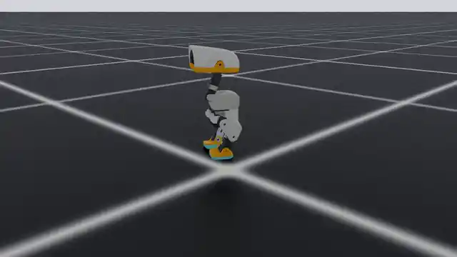

# MicroDuck RL for IsaacLab

This branch ports the complete
[`microduck_rl`](https://github.com/pollen-robotics/microduck_rl) training stack
to [IsaacLab](https://github.com/isaac-sim/IsaacLab). MicroDuck is an open-source
biped from [Pollen Robotics](https://github.com/pollen-robotics/microduck): about
25 cm tall and 800 g, with 14 Dynamixel XL330 servos controlling its legs,
neck, and head.

MicroDuck policies run at 50 Hz and share a 61-observation, 14-action contract.
That common interface lets walking, recovery, manipulation, trick, and roller
policies use the same robot runtime.

[](docs/source/_static/microduck/isaaclab_training_model1.mp4)

*IsaacLab PhysX rollout from `model_1.pt` after two PPO iterations. This is an
integration smoke checkpoint, not a converged locomotion policy. Select the
preview to open the 10-second MP4.*

## What is included

- MicroDuck walking, full-collision, passive-roller, backlash, ball, and XL330
  testbench models.
- BAM M6 actuator dynamics with voltage control, back-EMF, friction, battery
  sag, command delay, saturation, and encoder-through-backlash feedback.
- 21 primary task families plus 16 matching backlash families.
- Train and play registrations for all 37 environments: 74 Gym IDs in total.
- RSL-RL PPO configurations, mirror-loss symmetry, JIT export, and ONNX export.
- Source MJCF and mesh assets with deterministic layered-USD conversion.
- PhysX reset/step validation across the complete environment registry.

## Quick start

Requirements are Linux, Python 3.12, an NVIDIA GPU, Isaac Sim 6.0.0 or 6.0.1,
and [`uv`](https://docs.astral.sh/uv/).

```bash
git clone --branch 5usu/microduck-port https://github.com/5usu/IsaacLab.git
cd IsaacLab

uv sync --extra rl
uv run -- ./isaaclab.sh -p source/isaaclab_microduck/scripts/convert_assets.py
uv run -- ./isaaclab.sh -p -m pytest source/isaaclab_microduck/test
```

IsaacLab excludes generated USD files from source control. Run the asset
conversion once after cloning and again after changing an MJCF or mesh.

## Train

Train the flat-ground velocity policy:

```bash
uv run -- ./isaaclab.sh train --rl_library rsl_rl \
  --external_callback isaaclab_microduck.register_tasks \
  --task Isaac-Velocity-Flat-MicroDuck-v0 \
  --num_envs 4096 --viz none
```

Play the latest checkpoint:

```bash
uv run -- ./isaaclab.sh play --rl_library rsl_rl \
  --external_callback isaaclab_microduck.register_tasks \
  --task Isaac-Velocity-Flat-MicroDuck-Play-v0 \
  --num_envs 1 --viz kit
```

Record a checkpoint by adding `--video --video_length 500`. Select a specific
model with `--checkpoint /path/to/model.pt`; otherwise, IsaacLab loads the
latest checkpoint for the task. Playback exports TorchScript and ONNX policies
beside the loaded checkpoint.

## Tasks

Every task also has a `-Play-v0` registration with one environment and reduced
randomization.

| Family | Train task ID |
| --- | --- |
| Walking | `Isaac-Velocity-{Flat,Rough}-MicroDuck-v0` |
| Walking and recovery | `Isaac-VelStand-{Flat,Rough}-MicroDuck-v0` |
| Stand up | `Isaac-StandUp-{Flat,Rough}-MicroDuck-v0` |
| Sit and stand | `Isaac-SitStand-{Flat,Rough}-MicroDuck-v0` |
| Ground pick | `Isaac-GroundPick-{Flat,Rough}-MicroDuck-v0` |
| Ball kick | `Isaac-BallKick-Flat-MicroDuck-v0` |
| Roller velocity | `Isaac-Velocity-Flat-MicroDuck-Rollers-v0` |
| Roller swizzle | `Isaac-Velocity-Swizzle-MicroDuck-v0` |
| Roller crouch | `Isaac-RollerCrouch-Flat-MicroDuck-v0` |
| Roller slope | `Isaac-RollerSlope-Flat-MicroDuck-v0` |
| Roller stand up | `Isaac-RollerStandUp-Flat-MicroDuck-v0` |
| Roller spin | `Isaac-Spin-Flat-MicroDuck-v0` |
| Forward roll | `Isaac-Roulade-Flat-MicroDuck-v0` |
| Standing backflip | `Isaac-Backflip-Flat-MicroDuck-v0` |
| Parkour | `Isaac-Parkour-MicroDuck-v0` |
| XL330 testbench | `Isaac-Position-XL330-TestBench-v0` |

The 16 `Backlash` families insert physical serial gear play into each actuated
joint while preserving the policy observation and action dimensions.

## Policy interface

Production policies receive 61 observations:

| Range | Signal | Size |
| --- | --- | ---: |
| `[0:3]` | Base angular velocity | 3 |
| `[3:6]` | Projected gravity | 3 |
| `[6:9]` | Velocity command | 3 |
| `[9:23]` | Joint position | 14 |
| `[23:37]` | Joint velocity | 14 |
| `[37:51]` | Previous action | 14 |
| `[51:55]` | Head command | 4 |
| `[55:61]` | Body command | 6 |

The 14 actions target the five joints in each leg and four neck/head joints.
Passive rollers and backlash hinges are excluded from the action vector. The
fixed-base XL330 testbench has a separate four-observation, one-action contract.

## Repository layout

```text
source/isaaclab_microduck/
|-- isaaclab_microduck/
|   |-- actuators/                    # BAM actuator and configuration
|   |-- assets/                       # IsaacLab robot configurations
|   |-- data/robots/                  # MJCF, meshes, and conversion inputs
|   `-- tasks/
|       |-- manager_based/microduck/  # Environment and RSL-RL configurations
|       `-- mdp/                      # Commands, rewards, events, and resets
|-- scripts/convert_assets.py         # Deterministic MJCF-to-USD conversion
|-- test/                             # Port regression tests
`-- docs/                             # Detailed usage and migration notes
```

See the [extension guide](source/isaaclab_microduck/docs/README.md) for detailed
commands and the [migration matrix](source/isaaclab_microduck/docs/migration.md)
for validation coverage.

## IsaacLab base

This fork is based on IsaacLab 3.0.0 Beta 2 and supports Isaac Sim 6.0.0 and
6.0.1. The upstream framework provides the simulator integration, manager-based
environment API, rendering, and maintained reinforcement-learning entrypoints.
Refer to the [IsaacLab documentation](https://isaac-sim.github.io/IsaacLab) for
framework installation and troubleshooting.

## License

IsaacLab is distributed under the repository's [BSD-3-Clause license](LICENSE).
The MicroDuck extension is distributed under
[Apache License 2.0](source/isaaclab_microduck/LICENSE). MicroDuck mesh and CAD
assets retain the source project's Creative Commons BY-SA-NC terms. See the
[third-party notices](source/isaaclab_microduck/docs/THIRD_PARTY_NOTICES.md) for
provenance.

MicroDuck is developed by Pollen Robotics. The BAM actuator model is developed
by [Rhoban](https://github.com/Rhoban/bam), and IsaacLab is developed by NVIDIA
and its contributors.
